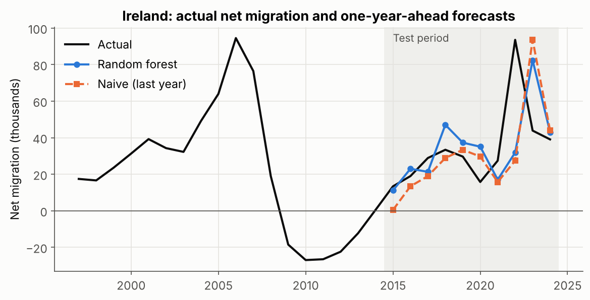
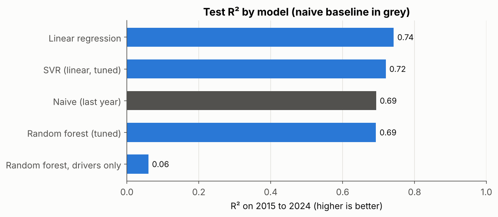
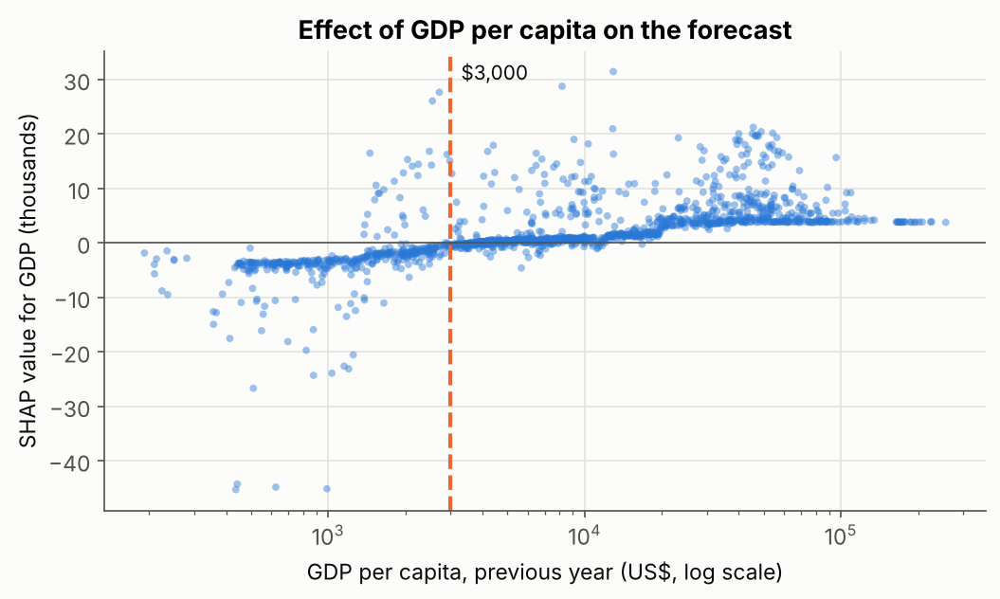

# Forecasting Net Migration with Machine Learning

Can a country's recent migration history, together with last year's economic and political indicators, forecast its net migration one year ahead? This project tests that on World Bank data for 160 countries, with forecasts for 2015 to 2024 checked against a simple baseline.

It started as my MSc dissertation in Data Analytics (Dublin Business School, 2025). I rebuilt the analysis afterwards to fix problems in the original method. [What changed](#what-changed-from-the-dissertation) explains each fix.



## Key findings

- **Migration has strong momentum.** Just repeating last year's figure explains 69% of the variation (R² 0.69).
- **Machine learning adds a little.** Linear regression does best (R² 0.74, about 8% lower RMSE than the baseline). A tuned random forest only matches the baseline.
- **Country by country, the baseline is hard to beat.** It is more accurate than every model for most countries. The models gain mainly on large swings in big countries.
- **Economic indicators alone explain very little.** Without migration history, the random forest scores an R² of 0.06.
- **GDP per capita matters in one clear direction.** SHAP values show that below roughly $3,000 per person, GDP pushes forecasts towards emigration, and above it towards immigration. The change is a gradual slope rather than a sudden jump.
- **Shocks break every model.** COVID-19 (2020) and the war in Ukraine (2022) produced the biggest errors.

## Results (test set, 2015 to 2024)

| Model | R² | MAE | RMSE | Countries where it beats the baseline |
|---|---|---|---|---|
| Naive baseline (last year's value) | 0.693 | 32,530 | 101,672 | n/a |
| Linear regression | **0.742** | 33,889 | **93,240** | 32% |
| SVR, linear kernel (tuned) | 0.720 | **32,496** | 97,164 | **41%** |
| Random forest (tuned) | 0.693 | 33,904 | 101,782 | 24% |
| Random forest, indicators only | 0.060 | 73,823 | 178,013 | 7% |

MAE and RMSE are in people per year.

<p>
  
  
</p>

## Method

1. **Data.** Six World Bank indicators from 1975 to 2024: net migration, GDP per capita, unemployment, political stability, poverty rate and remittance cost. Regional and income-group aggregates are removed so countries are not counted twice.
2. **Features.** Net migration from the previous 1, 2 and 3 years, plus GDP per capita (log), unemployment and political stability from the previous year. Gaps are filled only with earlier values. Poverty rate (90% missing) and remittance cost (97% missing) are left out.
3. **Split.** Train on 1997 to 2014, test on 2015 to 2024. Hyperparameters are tuned on two rolling folds inside the training years (validating on 2005 to 2009 and 2010 to 2014).
4. **Models.** Naive baseline, linear regression, random forest and support vector regression. Imputation and scaling sit inside scikit-learn pipelines, so they only see training data.
5. **Explaining the model.** SHAP values for the tuned random forest.

## What changed from the dissertation

| Original | Revised | Why |
|---|---|---|
| Rows sorted by country, first 80% used for training | Train on earlier years, test on later years | The original split tested on different countries over the same years, so it did not measure forecasting |
| Gaps filled forwards and backwards | Forwards only | Backward filling copies future values into the past |
| Indicators from the same year as the target | From the previous year | Same-year values are not available when you forecast |
| Imputer fitted on all data | Fitted inside the pipeline on training data | Keeps test data out of training |
| Regional aggregates included | Removed | They double count countries |
| No baseline | Naive last-year forecast | Shows what the models really add |
| Reported R² of 0.86 | Best R² of 0.74, against a baseline of 0.69 | The 0.86 came from the flawed split |

The original also described an LSTM model. It is not included here because only results this notebook reproduces are reported.

## Limitations and next steps

- **Partial coverage.** The bundled CSV came from a manual World Bank export capped at 30,000 rows, so it covers countries alphabetically from Afghanistan to Romania. `scripts/download_wdi.py` downloads all countries.
- **Large countries dominate.** Net migration is a raw count. Modelling migration per 1,000 people would weigh countries more evenly.
- **One year ahead only.** Multi-year forecasts would be more useful for planning, and harder.

## Run it yourself

Requires Python 3.10 or later.

```bash
git clone https://github.com/latedeveloper08/Migration-forecasting.git
cd Migration-forecasting
pip install -r requirements.txt
jupyter notebook notebooks/migration_forecasting.ipynb
```

To use the full country list, run `python scripts/download_wdi.py` first and point `DATA` in the notebook to `data/wdi_full.csv`.

## Project structure

```
├── data/
│   ├── README.md                    source and licence
│   └── wdi_migration_extract.csv    World Bank extract used for the results above
├── figures/                         charts and results.csv, written by the notebook
├── notebooks/
│   └── migration_forecasting.ipynb  full analysis
├── scripts/
│   └── download_wdi.py              downloads all countries from the World Bank API
├── src/
│   └── prep.py                      loading, cleaning and feature building
└── requirements.txt
```

## Tools

Python, pandas, NumPy, scikit-learn, SHAP, Matplotlib, Jupyter

## Data source

World Bank, [World Development Indicators](https://databank.worldbank.org/source/world-development-indicators) and [Worldwide Governance Indicators](https://www.worldbank.org/en/publication/worldwide-governance-indicators), licensed under [CC BY 4.0](https://creativecommons.org/licenses/by/4.0/).

## Author

Bens Binu Samuel · [LinkedIn](https://www.linkedin.com/in/bens-samuel)
